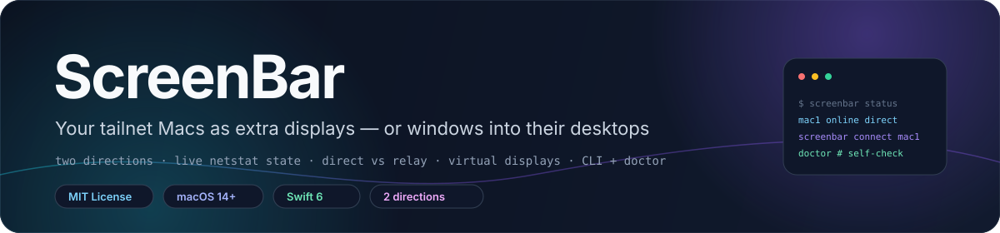
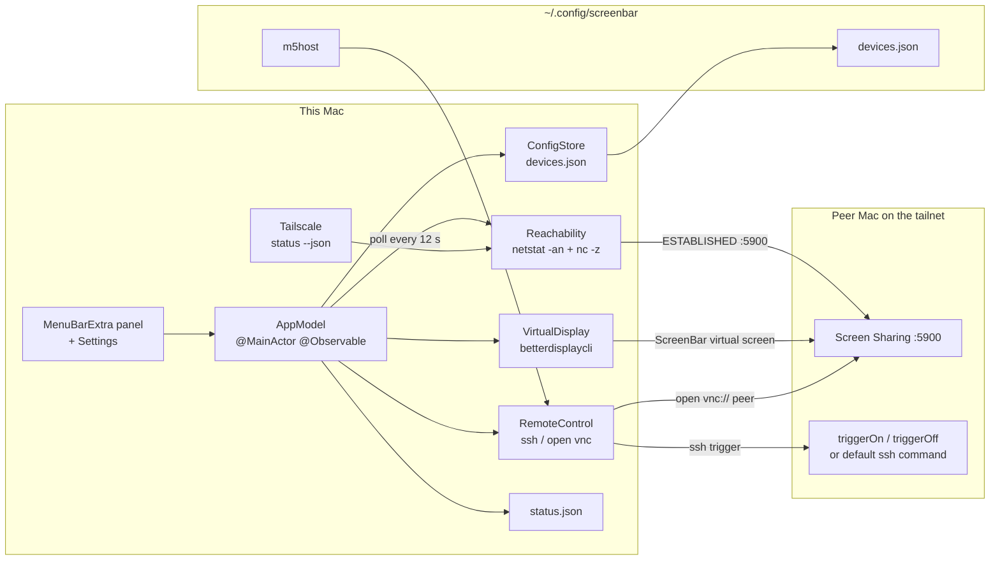

<div align="center">



# ScreenBar

**Turn the Macs on your tailnet into extra displays — or windows into their desktops.**

Second-screen direction · remote view · direct-vs-relay link quality · per-device virtual displays · CLI with `doctor`

[**简体中文**](README.zh-CN.md) · **English**

<a href="LICENSE"></a>
<a href="Package.swift"></a>
<a href="Package.swift"></a>
<a href=".github/workflows/ci.yml"></a>
<a href="docs/reference.md"></a>

</div>

> [!NOTE]
> **Current state.** v5.0.0, the version string baked into `Scripts/build-app.sh`. The repository holds
> the SwiftUI menu-bar app, a CLI in the same binary, a 17-test Swift Testing suite, and a CI workflow
> that runs `swift build` + `swift test`. Distribution is source-only: no notarized download, no
> Xcode project, no app icon.

## ✨ Features

- **State from real sockets.** `netstat -an` is parsed for `ESTABLISHED` connections whose local or
  foreign address ends in `:5900`: inbound means the peer is acting as this Mac's second screen,
  outbound means this Mac is viewing the peer.
- **Parallel reachability probes.** Every refresh runs `nc -z -G5` against each device's SSH port and,
  for view-enabled devices, port 5900.
- **Direct vs relay.** `tailscale status --json` classifies each online peer as `direct` (non-empty
  `CurAddr`) or `relay`; relay is labelled as lagging for second-screen use.
- **Per-device virtual displays.** Each device gets a BetterDisplay virtual screen named
  `ScreenBar-<id>` with its own resolution and HiDPI flag, so several peers can be attached at once.
- **Auto-connect and reconnect.** Devices flagged `autoConnect` attach as soon as they come online; a
  manual disconnect suppresses auto-connect until that device drops offline and returns.
- **Post-connect verification.** Six probes at 3-second intervals (18 s) follow a connect attempt, then
  a macOS notification reports success or an actionable hint.
- **Orphan screen cleanup.** A virtual screen attached by the app is disconnected after three
  consecutive polls (~36 s) without an active session, and `caffeinate` is released when nothing is
  active.
- **Wake-on-LAN.** A 102-byte magic packet (6 × `0xFF` + MAC × 16) is broadcast to
  `255.255.255.255:9`; the MAC is back-filled over SSH from `ifconfig en0` the first time a device is
  online.
- **Two remote-view paths.** `open vnc://<host>` for Screen Sharing, or `jump://connect?id=<uuid>` for
  Jump Desktop's Fluid protocol when the device has a `jumpID`.
- **Trigger overrides.** Any device can replace the default SSH choreography with its own
  `triggerOn` / `triggerOff` shell command, run through `/bin/bash -lc`.
- **Sleep blocking on both ends.** `caffeinate -d` runs locally while a second-screen session is up, and
  on the default SSH path the peer starts its own `caffeinate` tracked by PID in `/tmp/.screenbar-caf`.
- **Same-binary CLI.** Ten subcommands select CLI mode on the first argument; anything else launches
  the menu-bar UI.
- **Status export.** Every refresh rewrites `~/.config/screenbar/status.json` with an ISO-8601
  timestamp and one entry per device.
- **Launch at login.** An `SMAppService` toggle in Settings, plus a `LaunchAgent` with
  `RunAtLoad` + `KeepAlive` installed by the build script.
- **Built-in self-check.** `screenbar doctor` inspects the BetterDisplay CLI, Tailscale peers, Jump
  Desktop, this Mac's `:5900` listener, and each device's readiness.

## 🧠 Architecture



The code is split by responsibility under [`Sources/ScreenBar`](Sources/ScreenBar): `Model` holds the
`Device` / `DeviceMode` / `DeviceStatus` / `StatusDump` types, `Store` persists the device list,
`State/AppModel.swift` is the `@MainActor @Observable` hub that owns polling, network-change handling,
auto-connect, verification and orphan cleanup, `Services` wraps every system dependency, `UI` holds the
menu panel and settings window, and `CLI` dispatches the command set. Every external command
(`netstat`, `nc`, `tailscale`, `betterdisplaycli`, `ssh`, `open`, `osascript`, `bash`) goes through
`Services/Shell.swift`, which runs `Process` directly and never routes arguments through a shell unless
`Shell.bash` is used explicitly.

Persistence and constant paths are defined in [`Util/Constants.swift`](Sources/ScreenBar/Util/Constants.swift);
the JSON shapes and per-device fields are documented in [`docs/reference.md`](docs/reference.md).

## 🚀 Quick start

**Requirements:** macOS 14+ (Sonoma), a Swift 6 toolchain (SwiftPM, no Xcode project required),
[BetterDisplay](https://github.com/waydabber/BetterDisplay) for the second-screen direction, a
[Tailscale](https://tailscale.com) tailnet or otherwise reachable LAN, Screen Sharing enabled on peers,
and key-based SSH to peers for the default trigger path.

```sh
git clone https://github.com/LeoLin990405/ScreenBar.git
cd ScreenBar
swift build
swift test
Scripts/build-app.sh   # release bundle -> ~/Applications/ScreenBar.app
```

`Scripts/build-app.sh` builds the release binary, writes the `.app` bundle and its `Info.plist`
(`LSUIElement=true`, bundle id `com.leo.screenbar`), signs it ad-hoc, symlinks
`~/bin/screenbar`, installs `~/Library/LaunchAgents/com.leo.screenbar.plist`, then restarts the app.

Tell peers where to dial back, then verify:

```sh
mkdir -p ~/.config/screenbar
printf '%s\n' '<this-mac-tailscale-ip>' > ~/.config/screenbar/m5host
screenbar status
screenbar doctor
```

Install BetterDisplay's CLI with
`brew install waydabber/betterdisplay/betterdisplaycli`; ScreenBar looks for it at the hard-coded path
`/opt/homebrew/bin/betterdisplaycli`.

> [!WARNING]
> `Scripts/build-app.sh` deletes and recreates `~/Applications/ScreenBar.app`, replaces the existing
> `LaunchAgent`, kills any running `ScreenBar` process, and starts a new one. It is an install script,
> not a packaging step — read it before running it on a machine you already use.

## 🖥️ Two directions

| Direction | What shows what | Mechanism |
|---|---|---|
| **Second screen** | the peer shows this Mac | this Mac creates a BetterDisplay virtual screen; the peer connects over Screen Sharing and goes full-screen, becoming an extra monitor |
| **Remote view** | this Mac shows the peer | this Mac acts as a Screen Sharing or Jump Desktop client, so headless Mac minis are viewable too |

A device's `modes` field can be `screen`, `view`, or `both`, and decides which menu section it appears
in. The peer's Screen Sharing login is handled by macOS, not by ScreenBar: tick **Remember password** on
first connect, choose **Standard** display mode (not High Quality, which dedicates and blanks the main
display), and pick the matching `ScreenBar-<id>` entry once in the peer's Displays menu.

## ⌨️ CLI

The same executable doubles as a CLI, symlinked to `~/bin/screenbar` by the build script.

| Command | Effect |
|---|---|
| `screenbar status` | all devices: online / viewable / acting as screen / viewing, plus link type |
| `screenbar list` | `id · name · mode · host` |
| `screenbar connect <id>` | attach the device as a second screen |
| `screenbar disconnect <id>` | detach it and disconnect its virtual screen |
| `screenbar view <id>` | open a VNC view of the device on this Mac |
| `screenbar unview` | close all Screen Sharing windows on this Mac |
| `screenbar jump <id>` | view through Jump Desktop (Fluid), requires a `jumpID` |
| `screenbar wake <id>` | send a Wake-on-LAN packet |
| `screenbar doctor` | check the environment and per-device readiness |
| `screenbar help` | print usage |

Full command output formats, the device JSON schema, the `status.json` shape, and the diagnostics
checklist live in [`docs/reference.md`](docs/reference.md).

## ⚙️ Configuration

| Path | Written by | Contents |
|---|---|---|
| `~/.config/screenbar/devices.json` | the app, seeded on first run | device list: id, label, mode, host, SSH port and target, resolution, HiDPI, auto-connect, MAC, Jump ID, trigger overrides |
| `~/.config/screenbar/m5host` | you, one line | this Mac's Tailscale IP that peers dial with `open vnc://`; a placeholder address is used when the file is missing |
| `~/.config/screenbar/status.json` | the app, every refresh | ISO-8601 timestamp plus one status entry per device |

None of these files are committed. The first-run seed contains three example devices with RFC 5737
documentation addresses, so replace them in **Settings → Device Management** before use.

## 📁 Repository layout

| Path | Contents |
|---|---|
| `Sources/ScreenBar/ScreenBarApp.swift` | `@main` — `MenuBarExtra` panel, Settings scene |
| `Sources/ScreenBar/Model/` | `Device`, `DeviceMode`, `DeviceStatus` (incl. `LinkType`), `StatusDump` |
| `Sources/ScreenBar/Store/` | `ConfigStore` — JSON persistence and the first-run seed |
| `Sources/ScreenBar/State/` | `AppModel` — polling hub, auto-connect, verification, cleanup |
| `Sources/ScreenBar/Services/` | `Shell`, `Reachability`, `Tailscale`, `VirtualDisplay`, `RemoteControl`, `Connector`, `LaunchAtLogin`, `Diagnostics` |
| `Sources/ScreenBar/UI/` | `MenuView`, `PreferencesView`, `DeviceEditView` |
| `Sources/ScreenBar/CLI/` | `CLI.swift` — same-binary command line |
| `Tests/ScreenBarTests/` | netstat parsing, Tailscale parsing, Wake-on-LAN, config codec, CLI command set |
| `Scripts/build-app.sh` | release build, `.app` bundle, CLI symlink, `LaunchAgent` install |
| `.github/workflows/ci.yml` | `swift build` + `swift test` on `macos-15` |

## 🛠️ Development

```sh
swift build                 # debug build
swift test                  # 17 test functions in 6 Swift Testing suites
swift build -c release      # release binary
bash Scripts/build-app.sh   # bundle + install (see the warning above)
```

The package has no external Swift dependencies — `Package.swift` declares only the executable target
and the test target, with `.macOS(.v14)` as the platform and `swift-tools-version: 6.0`. Tests use the
Swift Testing framework and cover pure logic only: `netstat` line parsing, Tailscale `status --json`
parsing, the Wake-on-LAN packet layout, `Device` JSON round-tripping, the CLI command set, and device
mode capabilities. Nothing in the suite opens a socket, spawns an SSH process, or calls BetterDisplay.

CI (`.github/workflows/ci.yml`) runs `swift --version`, `swift build`, and `swift test` on a
`macos-15` runner for pushes to `main`, pull requests, and manual dispatch. Behavior that depends on a
real tailnet, a reachable peer, or BetterDisplay is not covered by the suite and has to be checked by
hand with `screenbar doctor`.

## 🧭 Scope, limits & roadmap

ScreenBar is a personal-scale control surface for a handful of Macs. It shells out to the tools you
already have instead of implementing screen transport itself. Known boundaries:

- **Not a screen-sharing implementation.** Pixel transport is macOS Screen Sharing, or Jump Desktop
  when configured. ScreenBar only orchestrates connections and virtual displays.
- **Hard-coded BetterDisplay path.** `Services/VirtualDisplay.swift` uses
  `/opt/homebrew/bin/betterdisplaycli`, and `Diagnostics` checks that exact path. Intel Homebrew
  installs (`/usr/local/bin`) are not detected.
- **SSH assumptions.** The default second-screen trigger needs key-based, non-interactive SSH to the
  peer (`BatchMode=yes`, `ConnectTimeout=12`); otherwise you must supply a `triggerOn` / `triggerOff`
  override.
- **Remote sharing toggle needs passwordless sudo.** `enableSharing` runs `kickstart` over SSH and only
  succeeds when the peer's `sudo` is `NOPASSWD`; ScreenBar never handles passwords.
- **Jump Desktop is invisible to status.** Jump uses its own protocol rather than `:5900`, so `viewing`
  never lights up for a Jump session and the menu keeps offering the Jump action.
- **Polling granularity.** State refreshes every 12 s or on a network path change, so a device can appear
  offline for up to one interval after it comes back.
- **Chinese-only strings.** Menu labels, CLI output, and diagnostics text are Chinese; there is no
  localization layer.
- **No discovery, no release pipeline.** Devices are added by hand (host or Tailscale IP plus an SSH
  target), the bundle is ad-hoc signed, and there is no notarized download.

Roadmap:

- [ ] Extract UI and CLI strings behind a localization table with an English default
- [ ] Resolve `betterdisplaycli` from `PATH` and both Homebrew prefixes instead of a fixed path
- [ ] Detect Jump Desktop sessions so the `viewing` state is accurate
- [ ] Add device discovery from `tailscale status --json` peers
- [ ] Ship an app icon and a signed, notarized release path

## 🤝 Contributing

Issues and pull requests are welcome. Before opening a PR:

1. run `swift build` and `swift test`;
2. keep system interaction inside `Services/` and behind `Shell` so it stays inspectable;
3. do not commit `~/.config/screenbar/*` contents, real hostnames, tailnet addresses, or MAC addresses;
4. update [`docs/reference.md`](docs/reference.md) when a command, config field, or check changes.

If ScreenBar is useful to you, consider leaving a ⭐ — it helps others find the project.

## 📄 License & attribution

ScreenBar is released under the [MIT License](LICENSE), © 2026 Leo Lin. The repository has no `NOTICE`
file and vendors no third-party source. The external tools it calls are separate programs, not
redistributed here: BetterDisplay (`betterdisplaycli`), Tailscale, macOS Screen Sharing, Jump Desktop,
`ssh`, `netstat`, `nc`, and `osascript`.

## ⭐ Star history

<div align="center">

<a href="https://star-history.com/#LeoLin990405/ScreenBar&Date">
  
</a>

</div>
