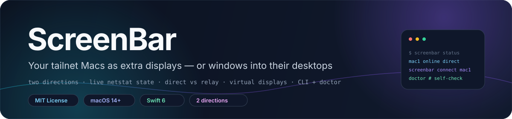
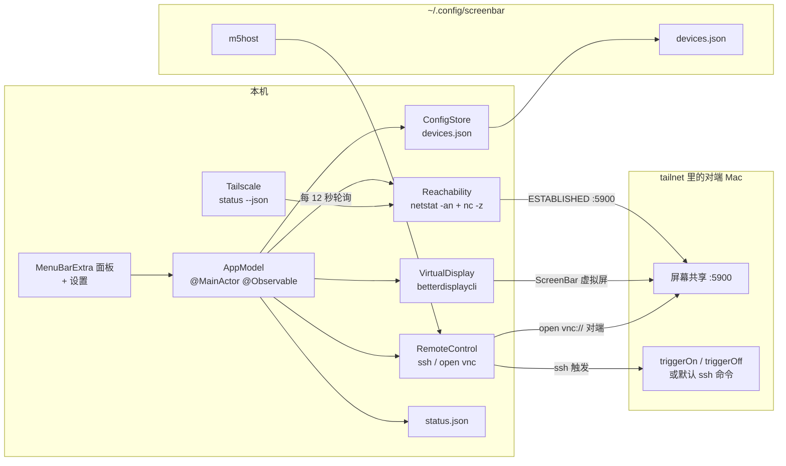

<div align="center">



# ScreenBar

**把 tailnet 里的 Mac 变成扩展屏 —— 或变成它们桌面的窗口。**

副屏方向 · 远程查看 · 直连/中继链路判断 · 每设备独立虚拟屏 · 带 `doctor` 的命令行

**简体中文** · [**English**](README.md)

<a href="LICENSE"></a>
<a href="Package.swift"></a>
<a href="Package.swift"></a>
<a href=".github/workflows/ci.yml"></a>
<a href="docs/reference.md"></a>

</div>

> [!NOTE]
> **当前状态。** v5.0.0，版本号写在 `Scripts/build-app.sh` 里。仓库包含 SwiftUI 菜单栏 app、同一二进制里的
> CLI、17 个用例的 Swift Testing 测试套件，以及跑 `swift build` + `swift test` 的 CI workflow。
> 只以源码分发：没有公证过的下载包，没有 Xcode 工程，也没有 app 图标。

## ✨ 特性

- **状态来自真实连接。** 解析 `netstat -an` 中本地或对端地址以 `:5900` 结尾的 `ESTABLISHED` 连接：
  入向表示对方正在当本机副屏，出向表示本机正在查看对方。
- **并行可达性探测。** 每轮刷新对每台设备的 SSH 端口跑一次 `nc -z -G5`；支持查看的设备再加测 5900 端口。
- **直连 vs 中继。** `tailscale status --json` 把在线 peer 分成 `direct`（`CurAddr` 非空）与 `relay`；
  中继链路在界面上标注为「会卡」。
- **每设备独立虚拟屏。** 每台设备对应一块名为 `ScreenBar-<id>` 的 BetterDisplay 虚拟屏，各自带分辨率与
  HiDPI 设置，所以可以同时挂多台。
- **自动连接与重连。** 勾了 `autoConnect` 的设备一上线就自动挂成副屏；手动断开后不会被抢回，直到该设备
  先离线再上线。
- **连接后验证。** 连接动作之后以 3 秒间隔探测 6 次（共 18 秒），再用系统通知报告成功或给出可操作提示。
- **孤儿屏清理。** app 挂上的虚拟屏若连续三轮（约 36 秒）没有活跃会话就断开；没有活跃副屏时收回
  `caffeinate`。
- **Wake-on-LAN。** 向 `255.255.255.255:9` 广播 102 字节魔术包（6 个 `0xFF` + MAC 重复 16 次）；
  设备首次在线时通过 SSH 从 `ifconfig en0` 自动补全 MAC。
- **两条查看通道。** `open vnc://<host>` 走屏幕共享；设备填了 `jumpID` 时用
  `jump://connect?id=<uuid>` 走 Jump Desktop 的 Fluid 协议。
- **触发覆盖。** 任意设备都可以用自定义 `triggerOn` / `triggerOff` shell 命令替换默认 SSH 流程，
  命令经 `/bin/bash -lc` 执行。
- **两端防息屏。** 副屏会话期间本机跑 `caffeinate -d`；走默认 SSH 路径时对方机器也会起一个
  `caffeinate`，PID 记在 `/tmp/.screenbar-caf`。
- **同一二进制兼作 CLI。** 十个子命令；首个参数命中命令则走 CLI，否则启动菜单栏界面。
- **状态导出。** 每轮刷新都会重写 `~/.config/screenbar/status.json`，带 ISO-8601 时间戳与每台设备一条记录。
- **开机自启。** 设置里有 `SMAppService` 开关，构建脚本还会装一个 `RunAtLoad` + `KeepAlive` 的
  `LaunchAgent`。
- **内置自检。** `screenbar doctor` 检查 BetterDisplay CLI、Tailscale peer、Jump Desktop、本机 `:5900`
  监听，以及每台设备的就绪度。

## 🧠 架构



代码按职责拆在 [`Sources/ScreenBar`](Sources/ScreenBar) 下：`Model` 放 `Device` / `DeviceMode` /
`DeviceStatus` / `StatusDump` 类型，`Store` 负责设备清单持久化，`State/AppModel.swift` 是
`@MainActor @Observable` 中枢（轮询、网络变化、自动连接、连接验证、孤儿清理），`Services` 封装全部
系统依赖，`UI` 是菜单面板与设置窗口，`CLI` 负责命令分发。所有外部命令（`netstat`、`nc`、
`tailscale`、`betterdisplaycli`、`ssh`、`open`、`osascript`、`bash`）都经
`Services/Shell.swift` 执行：直接起 `Process`，只有显式调用 `Shell.bash` 时才过 shell。

持久化路径与常量定义在 [`Util/Constants.swift`](Sources/ScreenBar/Util/Constants.swift)；各个 JSON
结构和设备字段说明见 [`docs/reference.md`](docs/reference.md)。

## 🚀 快速开始

**要求：** macOS 14+（Sonoma）、Swift 6 工具链（SwiftPM，不需要 Xcode 工程）、
[BetterDisplay](https://github.com/waydabber/BetterDisplay)（副屏方向需要）、
[Tailscale](https://tailscale.com) tailnet 或其他可达局域网、对端开启屏幕共享，默认触发路径还要求到
对端的 SSH 密钥免密。

```sh
git clone https://github.com/LeoLin990405/ScreenBar.git
cd ScreenBar
swift build
swift test
Scripts/build-app.sh   # release 打包 → ~/Applications/ScreenBar.app
```

`Scripts/build-app.sh` 会做 release 构建，生成 `.app` 与 `Info.plist`（`LSUIElement=true`，
bundle id 为 `com.leo.screenbar`），ad-hoc 签名，软链 `~/bin/screenbar`，安装
`~/Library/LaunchAgents/com.leo.screenbar.plist`，最后重启 app。

告诉对端该连回哪个地址，然后自检：

```sh
mkdir -p ~/.config/screenbar
printf '%s\n' '<本机 tailscale IP>' > ~/.config/screenbar/m5host
screenbar status
screenbar doctor
```

BetterDisplay 的 CLI 用 `brew install waydabber/betterdisplay/betterdisplaycli` 安装；ScreenBar 只认
硬编码路径 `/opt/homebrew/bin/betterdisplaycli`。

> [!WARNING]
> `Scripts/build-app.sh` 会删除并重建 `~/Applications/ScreenBar.app`、替换已有 `LaunchAgent`、
> 杀掉正在运行的 `ScreenBar` 进程再启动新的。它是安装脚本而不是打包步骤 —— 在已日常使用的机器上
> 执行前先读一遍。

## 🖥️ 两个方向

| 方向 | 谁显示谁 | 机制 |
|---|---|---|
| **当副屏** | 对方显示本机 | 本机造一块 BetterDisplay 虚拟屏；对方用屏幕共享连入并全屏，于是多出一台显示器 |
| **远程查看** | 本机显示对方 | 本机作 Screen Sharing 或 Jump Desktop 客户端，无头 Mac mini 也能看 |

设备的 `modes` 字段可以是 `screen`、`view` 或 `both`，决定它出现在菜单的哪个分组。对端的屏幕共享
登录由 macOS 处理，不经过 ScreenBar：首次连接勾 **记住密码**，显示器模式选 **标准**（不要选高质量，
那会独占并使主屏黑屏），真要多显示器时在对方「显示器」菜单里选一次对应的 `ScreenBar-<id>`。

## ⌨️ 命令行

同一个可执行文件兼作 CLI，构建脚本会把它软链到 `~/bin/screenbar`。

| 命令 | 作用 |
|---|---|
| `screenbar status` | 全部设备：在线 / 可查看 / 副屏中 / 查看中，附链路类型 |
| `screenbar list` | `id · 名称 · 方向 · host` |
| `screenbar connect <id>` | 让该设备当副屏 |
| `screenbar disconnect <id>` | 断开并收掉它的虚拟屏 |
| `screenbar view <id>` | 在本机用 VNC 查看该设备 |
| `screenbar unview` | 关掉本机所有屏幕共享窗口 |
| `screenbar jump <id>` | 用 Jump Desktop（Fluid）查看，需要 `jumpID` |
| `screenbar wake <id>` | 发 Wake-on-LAN 魔术包 |
| `screenbar doctor` | 检查环境与每台设备的就绪度 |
| `screenbar help` | 打印用法 |

完整的输出格式、设备 JSON 结构、`status.json` 形状与自检清单见
[`docs/reference.md`](docs/reference.md)。详细文档（docs/*）当前以英文为主。

## ⚙️ 配置

| 路径 | 谁写入 | 内容 |
|---|---|---|
| `~/.config/screenbar/devices.json` | app，首次运行自动播种 | 设备清单：id、名称、方向、host、SSH 端口与目标、分辨率、HiDPI、自动连接、MAC、Jump ID、触发覆盖 |
| `~/.config/screenbar/m5host` | 你，一行 | 本机 Tailscale IP，对端用它 `open vnc://`；文件缺失时使用占位地址 |
| `~/.config/screenbar/status.json` | app，每轮刷新 | ISO-8601 时间戳 + 每台设备一条状态 |

这三个文件都不进仓库。首次运行的种子数据是三台示例设备，用的是 RFC 5737 文档地址，用之前请在
**设置 → 设备管理** 里改掉。

## 📁 仓库结构

| 路径 | 内容 |
|---|---|
| `Sources/ScreenBar/ScreenBarApp.swift` | `@main` —— `MenuBarExtra` 面板与 Settings 场景 |
| `Sources/ScreenBar/Model/` | `Device`、`DeviceMode`、`DeviceStatus`（含 `LinkType`）、`StatusDump` |
| `Sources/ScreenBar/Store/` | `ConfigStore` —— JSON 持久化与首次运行种子 |
| `Sources/ScreenBar/State/` | `AppModel` —— 轮询中枢、自动连接、连接验证、清理 |
| `Sources/ScreenBar/Services/` | `Shell`、`Reachability`、`Tailscale`、`VirtualDisplay`、`RemoteControl`、`Connector`、`LaunchAtLogin`、`Diagnostics` |
| `Sources/ScreenBar/UI/` | `MenuView`、`PreferencesView`、`DeviceEditView` |
| `Sources/ScreenBar/CLI/` | `CLI.swift` —— 同一二进制的命令行 |
| `Tests/ScreenBarTests/` | netstat 解析、Tailscale 解析、Wake-on-LAN、配置编解码、CLI 命令集 |
| `Scripts/build-app.sh` | release 构建、`.app` 打包、CLI 软链、`LaunchAgent` 安装 |
| `.github/workflows/ci.yml` | `macos-15` 上跑 `swift build` + `swift test` |

## 🛠️ 开发

```sh
swift build                 # 调试构建
swift test                  # 6 个 Swift Testing 套件共 17 个测试函数
swift build -c release      # release 二进制
bash Scripts/build-app.sh   # 打包 + 安装（先看上面的警告）
```

包没有外部 Swift 依赖 —— `Package.swift` 只声明可执行 target 与测试 target，平台为 `.macOS(.v14)`，
`swift-tools-version: 6.0`。测试用 Swift Testing 框架，覆盖范围仅限纯逻辑：`netstat` 行解析、
Tailscale `status --json` 解析、Wake-on-LAN 包布局、`Device` JSON 往返、CLI 命令集、设备方向能力判定。
套件里没有任何用例开 socket、起 SSH 进程或调用 BetterDisplay。

CI（`.github/workflows/ci.yml`）在 `macos-15` runner 上对推送到 `main`、PR 与手动触发跑
`swift --version`、`swift build`、`swift test`。依赖真实 tailnet、可达对端或 BetterDisplay 的行为不在
套件覆盖面内，需要用 `screenbar doctor` 手工确认。

## 🧭 范围、限制与路线图

ScreenBar 是给少量 Mac 用的个人级控制台，只调度现成工具，不自己实现屏幕传输。已知边界：

- **不是屏幕共享实现。** 画面传输由 macOS 屏幕共享或配置好的 Jump Desktop 负责，ScreenBar 只编排
  连接与虚拟屏。
- **BetterDisplay 路径写死。** `Services/VirtualDisplay.swift` 使用
  `/opt/homebrew/bin/betterdisplaycli`，`Diagnostics` 也检查这一条路径；Intel Homebrew 装在
  `/usr/local/bin` 的情况识别不到。
- **SSH 假设。** 默认副屏触发要求到对端能免交互免密 SSH（`BatchMode=yes`、`ConnectTimeout=12`），
  否则要自己写 `triggerOn` / `triggerOff`。
- **远端开共享需要免密 sudo。** `enableSharing` 通过 SSH 跑 `kickstart`，只有对端 `sudo` 是
  `NOPASSWD` 才成功；ScreenBar 不接触任何密码。
- **Jump Desktop 对状态不可见。** Jump 走自有协议不经 `:5900`，所以 Jump 会话期间 `viewing` 不会点亮，
  菜单会一直提供 Jump 动作。
- **轮询粒度。** 状态每 12 秒或网络路径变化时刷新，设备恢复在线后最多要等一个周期才显示正常。
- **只有中文文案。** 菜单、CLI 输出与自检文字都是中文，没有本地化层。
- **无设备发现、无发布流水线。** 设备靠手工添加（host 或 Tailscale IP + SSH 目标），bundle 是
  ad-hoc 签名，也没有公证下载。

路线图：

- [ ] 把 UI 与 CLI 文案抽到本地化表，默认英文
- [ ] 从 `PATH` 与两种 Homebrew 前缀解析 `betterdisplaycli`，不再写死路径
- [ ] 识别 Jump Desktop 会话，让 `viewing` 状态准确
- [ ] 基于 `tailscale status --json` 的 peer 做设备发现
- [ ] 补 app 图标与签名、公证的发布路径

## 🤝 参与贡献

欢迎 Issue 与 PR。提交前请：

1. 跑 `swift build` 与 `swift test`；
2. 系统交互留在 `Services/` 里并统一走 `Shell`，方便审查；
3. 不要提交 `~/.config/screenbar/*` 的内容、真实主机名、tailnet 地址或 MAC 地址；
4. 命令、配置字段或检查项有变化时同步更新 [`docs/reference.md`](docs/reference.md)。

如果 ScreenBar 对你有帮助，欢迎点个 ⭐。

## 📄 许可证与署名

ScreenBar 使用 [MIT License](LICENSE)，© 2026 Leo Lin。仓库没有 `NOTICE` 文件，也没有内嵌第三方源码。
它调用的外部工具都是独立程序，不在本仓库分发：BetterDisplay（`betterdisplaycli`）、Tailscale、
macOS 屏幕共享、Jump Desktop、`ssh`、`netstat`、`nc`、`osascript`。

## ⭐ Star 历史

<div align="center">

<a href="https://star-history.com/#LeoLin990405/ScreenBar&Date">
  
</a>

</div>
